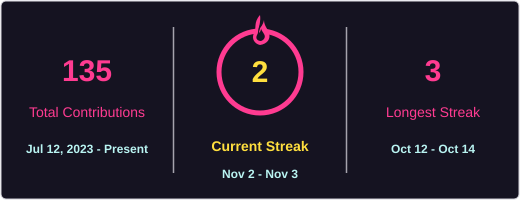

<h1 align="center">Muhammad Oddy Rizki Hartawan</h1>

  <strong>Software Developer · PWA & Android Developer · Data Analyst · UI/UX Designer</strong>

  
  

  

## 👨‍💻 About Me

I am a developer and data analyst based in Indonesia, currently studying at Universitas Pamulang. I build practical digital products, including offline-first web applications, progressive web apps, Android utilities, and data-focused tools. I am also interested in applying AI to research and productivity workflows.

- **Development:** JavaScript, TypeScript, React, Python, and Kotlin
- **Focus areas:** Web and mobile development, data analysis, automation, and AI-assisted research
- **Location:** Indonesia 🇮🇩
- **Availability:** Open to professional opportunities and freelance projects

---

## 📈 GitHub Stats

  

---

## 🛠️ Technologies

  
  
  
  
  
  
  
  
  
  
  
  
  
  

---

## 🚀 Project Portfolio

This portfolio highlights selected projects and areas of development across web, mobile, data, AI, and academic research. A dash (**—**) indicates that a public repository link is not currently listed.

### 🌐 Web Applications & PWAs

| Project | Description | Repository | Skills | Technologies |
|---|---|---|---|---|
| Portfolio Website | Personal website showcasing projects and professional experience | — | UI/UX, responsive design, frontend development | HTML5, CSS3 |
| Business Dashboard | Dashboard for analytics, automation, and activity monitoring | — | Dashboard development, data visualization, automation | React, TypeScript |

### 📱 Android Applications

| Project | Description | Repository | Skills | Technologies |
|---|---|---|---|---|
| Mobile Utility App | Productivity and automation companion for mobile users | — | Android development, mobile automation | Kotlin, Android |

### 🟦 TypeScript Applications

| Project | Description | Repository | Skills | Technologies |
|---|---|---|---|---|
| TypeScript Dashboard | Modern frontend application built with reusable components | — | Component architecture, frontend development | TypeScript, React |
| Admin Panel | Internal interface for managing data through tables, charts, and forms | — | Admin interfaces, form design, data visualization | TypeScript, Next.js |

### 📊 Data Analysis & Applications

| Project | Description | Repository | Skills | Technologies |
|---|---|---|---|---|
| Data Insights Dashboard | Dashboard for KPI reporting and business analysis | — | Data analysis, KPI reporting, visualization | Python, Pandas |
| Data Processing Tool | ETL and automation workflow for dataset processing | — | ETL, data processing, SQL | Python, SQL |

### 🐍 Python Applications

| Project | Description | Repository | Skills | Technologies |
|---|---|---|---|---|
| OpenJarvis | Voice assistant featuring text-to-speech, chatbot, and automation capabilities | — | Voice interfaces, chatbot development, automation | Python |
| codeflow-ai-reviewer | AI-assisted code review bot for GitHub pull requests | — | AI integration, code review workflows, CI/CD | Python, GitHub Actions |

### 🎓 Academic Projects & Research 

| Project | Description | Repository | Skills | Technologies |
|---|---|---|---|---|
| Agent Skripsi | AI agent project supporting academic and thesis-related work | [agent-skripsi-ku](https://github.com/oddycosplay/agent-skripsi-ku) | Academic research, thesis support, AI agents | — |
| AI Research Agent | AI agent focused on research workflows | [ai-research-agent](https://github.com/oddycosplay/ai-research-agent) | Research workflows, information synthesis, agent development | TypeScript |
| Scopus Q1 Introduction Evaluator | Skill for evaluating a research manuscript’s introduction using four guiding questions | [Repository](https://github.com/oddycosplay/Skill-Scopus-Q1-Introduction-Evaluator.md) | Academic writing, manuscript evaluation, research methodology | — |

---

## 🧠 Areas of Focus

  
  
  
  
  
  

---

Thank you for visiting my profile. Feel free to explore my repositories and projects.

